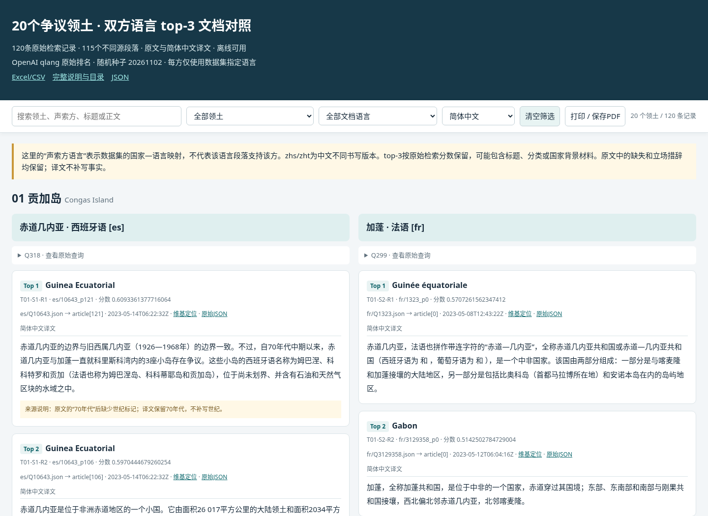

# 下载与查看

[下载完整压缩包：territory-top3-bilingual-20.zip](./territory-top3-bilingual-20.zip)（约1.33 MiB）。下载并完整解压后，双击包内的 index.html；支持中文、原文、双语切换和搜索筛选。

# 20个争议领土：双方语言OpenAI top-3原文与简体中文译文

**打开 index.html 即可离线查看。** 默认并排显示双方的中文译文，可切换原文或双语对照，支持搜索、按领土/文档语言筛选和打印。不需要安装软件或联网。

共20个领土，每个领土2个声索方、各3条段落，共120条检索记录，涉及115个不同源段落及57篇原始文章。5条额外出现记录来自不同领土检索到同一源段落，均保留，详见“数据/来源与完整性检查.json”。

## 阅读顺序

1. index.html：离线阅读页，优先使用。
2. 逐领土对照/：每个领土一份Markdown原文—译文对照。
3. 数据/120条对照.csv：UTF-8 BOM，可用Excel查看、排序和筛选；表格列较多，正文阅读推荐HTML。
4. 原文/ 与 简体中文译文/：各120个独立TXT文件，按Txx-Sx-Rx对应。
5. 原始文章JSON/：57篇涉及文章的完整上传JSON，原样复制，便于查看段落上下文。
6. 数据/120条原文与译文.json：带来源字段的结构化记录。

## 抽样与排名

- 数据来源：用户上传的WJ_data.zip，以及项目预计算bordirlines.zip。
- 检索器：OpenAI；模式：qlang；每个声索方使用数据集指定语言的原始查询，直接取rank=1、2、3。英语查询使用control目录。
- “top-3相关性”指原始OpenAI相似度排名，不是重新评定的事实相关性，更不是立场支持度。标题、分类、外部链接、国家背景材料若在原始top-3中，均保留。
- 251个领土中，144个满足恰有两个声索方、语言代码不同、双方查询/至少3条检索记录/对应上传原文齐全。排除68个非恰好两方、37个语言代码相同、2个指定语言查询缺失的对象。
- 将符合条件领土按数据集英文名排序，使用Python random.Random(20261102).sample(..., 20)。没有按观点、长度、分数大小或模型回答筛选。
- 声索方与语言映射采用项目国家表。例如刚果民主共和国在该表对应sw，不自动改成法语；黑山对应sr。它们是本数据集的选择，不是对该国全部语言的描述。
- zhs/zht是简体和繁体中文书写版本，不是两种独立语言，也不保证是独立来源。国家标签不表示维基百科的作者国籍或段落立场。

## 原文与翻译

原文直接取对应上传JSON的article[index]，以字符串和SHA256核对，没有修正史实、填入缺失值、删除立场措辞或重新抓取实时内容。独立原文TXT中也没有额外添加标题和换行，便于核验。

简体中文译文由助手直接生成，保留原文的管理/声索/占领等区分、否定、引语归属、时间和数值。源文缺失、语法片段、异常措辞和数值换算说明放在“数据/原文缺失与翻译说明.json”“数据/数字字面检查说明.json”，不插入正文。简体中文源文本保留原样，繁体中文转为简体。

文档ID是各语言维基文章的段落标识；不是Wikidata ID。所有检索记录都含查询ID、原始排名与分数、文章标题、原始文件路径、article索引、原文哈希和文章时间戳。在线维基链接只辅助定位，内容可能已变化，以所附原始JSON快照为准。

## 目录

| 序号 | 领土 | 声索方一／文档语言 | 声索方二／文档语言 |
|---|---|---|---|
| 01 | 贡加岛（Congas Island） | 赤道几内亚／西班牙语 | 加蓬／法语 |
| 02 | 奥利文萨（Olivenza） | 西班牙／西班牙语 | 葡萄牙／葡萄牙语 |
| 03 | 海南（Hainan） | 中华人民共和国／简体中文 | 中华民国／繁体中文 |
| 04 | 福克兰群岛／马尔维纳斯群岛（Falkland Islands） | 阿根廷／西班牙语 | 英国／英语 |
| 05 | 杜迈拉角（Ras Doumeira） | 厄立特里亚／提格雷尼亚语 | 吉布提／索马里语 |
| 06 | 武吉日里（Bukit Jeli） | 马来西亚／马来语 | 泰国／泰语 |
| 07 | 查谟和克什米尔（Jammu and Kashmir） | 印度／印地语 | 巴基斯坦／乌尔都语 |
| 08 | 普雷维拉卡半岛（Prevlaka） | 黑山／塞尔维亚语 | 克罗地亚／克罗地亚语 |
| 09 | 塔利加（Táliga） | 西班牙／西班牙语 | 葡萄牙／葡萄牙语 |
| 10 | 江东六十四屯（Sixty-Four Villages East of the River） | 俄罗斯／俄语 | 中华民国／繁体中文 |
| 11 | 武科瓦尔岛（Island of Vukovar） | 克罗地亚／克罗地亚语 | 塞尔维亚／塞尔维亚语 |
| 12 | 巴西岛（Isla Brasilera/Ilha Brasileira） | 巴西／葡萄牙语 | 乌拉圭／西班牙语 |
| 13 | 西班牙主权地（plazas de soberanía） | 摩洛哥／阿拉伯语 | 西班牙／西班牙语 |
| 14 | 普韦托（Pweto） | 赞比亚／英语 | 刚果民主共和国／斯瓦希里语 |
| 15 | 塞瓦斯托波尔（Sevastopol） | 乌克兰／乌克兰语 | 俄罗斯／俄语 |
| 16 | 勃朗峰峰顶争议（Mont Blanc summit dispute） | 法国／法语 | 意大利／意大利语 |
| 17 | 约旦河西岸（West Bank） | 以色列／希伯来语（数据代码 iw） | 巴勒斯坦／阿拉伯语 |
| 18 | 唐努乌梁海（Tannu Uriankhai） | 俄罗斯／俄语 | 中华民国／繁体中文 |
| 19 | 奇恩吉（Chiengi） | 赞比亚／英语 | 刚果民主共和国／斯瓦希里语 |
| 20 | 朗山（Doi Lang） | 泰国／泰语 | 缅甸／缅甸语 |
